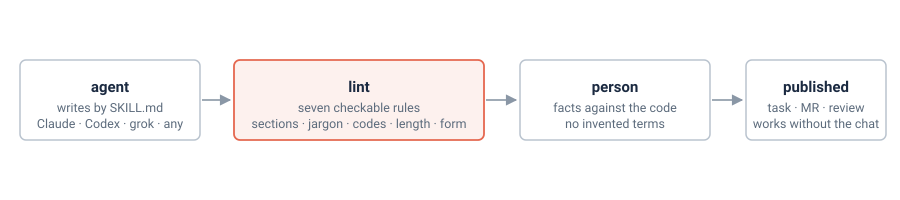

<p align="center">
  
</p>

# plain-writing

**One set of rules for text people read without your chat: a tracker task, a merge request
description, a review comment, a report.** The rules are a skill any coding agent can load. A script
checks the rules that can be checked. What it cannot check stays with a person.

<p>
  <a href="LICENSE"></a>
  
  
  <a href=".github/workflows/ci.yml"></a>
  <a href="README.ru.md"></a>
</p>

## What it is

The reader opens the text without the conversation that produced it: a developer from another
team, a tester, a lead a month later, the author in a new session. The text has to work on its own.
The skill says what to drop (history, internal codes, "out of scope" sections, self-assessment),
how to handle terms and facts, and what shape a task, an MR description, a review comment and a
report take. Full text in [skill/SKILL.md](skill/SKILL.md), in Russian. English translation:
[docs/en/SKILL.md](docs/en/SKILL.md).

The rules target Russian texts. The word lists and required section names are Russian, the
structural rules are not.

<picture>
  <source media="(prefers-color-scheme: dark)" srcset="docs/assets/flow-dark.svg">
  
</picture>

Two worked examples, the same text before and after the rules, with a breakdown of what changed:
[a task](skill/reference/task-before-after.md) and [an MR description](skill/reference/mr-before-after.md).

## Connect to an agent

Clone the repository. Every script can be run again: nothing is duplicated.

```bash
git clone https://github.com/genhoi/plain-writing.git ~/src/plain-writing
cd ~/src/plain-writing
```

**Claude Code.** Symlinks `skill/` into `~/.claude/skills/plain-writing` and adds one line to
`~/.claude/CLAUDE.md` if it is not there. The line says to load the skill with the Skill tool rather
than read the file: then Claude Code puts the rules back into context after compaction. `--copy`
copies instead of linking.

```bash
install/claude-code.sh
```

**Codex.** Adds one line to `~/.codex/AGENTS.md` with the path to `SKILL.md`.

```bash
install/codex.sh
```

**Any runtime with a skills directory** (grok, kimi, Gemini, Codex via `~/.agents/skills`).
Symlinks `skill/` into the directory you name.

```bash
install/skills-dir.sh ~/.agents/skills
install/skills-dir.sh ~/.grok/skills
```

**Anything else** (zcode, a web chat, a custom system prompt). Prints the skill without its
front matter, ready to paste into a system instruction.

```bash
install/print-skill.sh
```

## Check a text

Python 3.11 or newer, standard library only. A file or stdin in; one line per finding out, with the
line number and the rule name. Exit code 1 when there are findings, 2 when a file cannot be read.

```bash
python -m lint --kind task description.md
python -m lint --kind mr < mr.md
pbpaste | python -m lint
```

Output:

```
description.md:4: codes: «SHOP-410»: внутренний код без расшифровки: объяснить в том же абзаце или убрать
description.md:9: jargon: «fail-closed»: жаргон, замена: при сомнении отказывает
description.md:12: sections: раздел «Не входит»: убрать. Реальное ограничение идёт одним абзацем с причиной
```

The text is checked, not its markup: Markdown is the default, and the Jira wiki markup (`h2.`, `#` items, `{{name}}`, `{code}`) is understood as well.

| Rule | What it finds | Where the list lives |
|---|---|---|
| `sections` | Headings "Не входит", "Что осталось за бортом", "Что не сделано", "Out of scope" and the like | `lint/rules.py` |
| `jargon` | Calques and jargon, each with a replacement | `lint/jargon.txt` |
| `codes` | Tracker keys like `NP-12` (a project prefix and a number), MR numbers, branch names next to the word "ветка" or "branch", with no explanation in the same paragraph. Not counted: standards such as UTF-8 or SHA-256; a code that is a link; a code in brackets after a statement ("(NP-12)", "(задача NP-12)") or in a "Closes NP-12" line; a code inside a path in backticks | `lint/codes.txt` for codes, `lint/rules.py` for branches |
| `self-praise` | "минимальный", "аккуратно", "честно", "очень полезно" and the like | `lint/self-praise.txt` |
| `length` | A sentence over 35 words, a paragraph over 8 sentences | `lint/rules.py` |
| `task-form` | With `--kind task`: sections "Проблема", "Что сделать", "Как проверить"; a numbered list under "Что сделать" where every item names a class, table or method in backticks; no classes, methods or tests under "Как проверить": a tester reads it | `lint/rules.py` |
| `mr-form` | With `--kind mr`: sections "Зачем", "Что изменилось", "Проверки" (or "Как проверено") | `lint/rules.py` |

The word lists are one entry per line: the word, then a replacement after a tab, then an optional
list of words that cancel the match when they follow it. That list is why "минимальная сумма" is
not self-praise. An entry matches the word and up to three letters of ending, so `минимальн` finds
"минимальный" and "минимальные". A word in quotes is a mention, not a use, and is skipped. A code is
explained when it is followed by a bracket, a colon, a dash, "это" or "то есть". Code blocks, HTML
lines are not checked.

**What the lint does not do.** It does not check whether a statement about the system is true, and
it does not find made-up terms. Both stay with the person publishing the text; the rule is in
`SKILL.md`.

## Tests

```bash
pip install pytest
pytest
```

Every rule has a test that it fires and a test that it stays quiet. The examples in
`skill/reference/` are fixtures: the "before" texts must produce findings, the "after" texts must
pass. CI runs the same on every push, plus the lint on this README and a double run of every
install script.

## Related

[external-review](https://github.com/genhoi/external-review) sends code and plans to other model
families for a second opinion. [evidence-first-design](https://github.com/genhoi/evidence-first-design)
makes the executor measure what the system already computed before designing a fix. This
repository covers the text that comes out of both.

## License

MIT.
